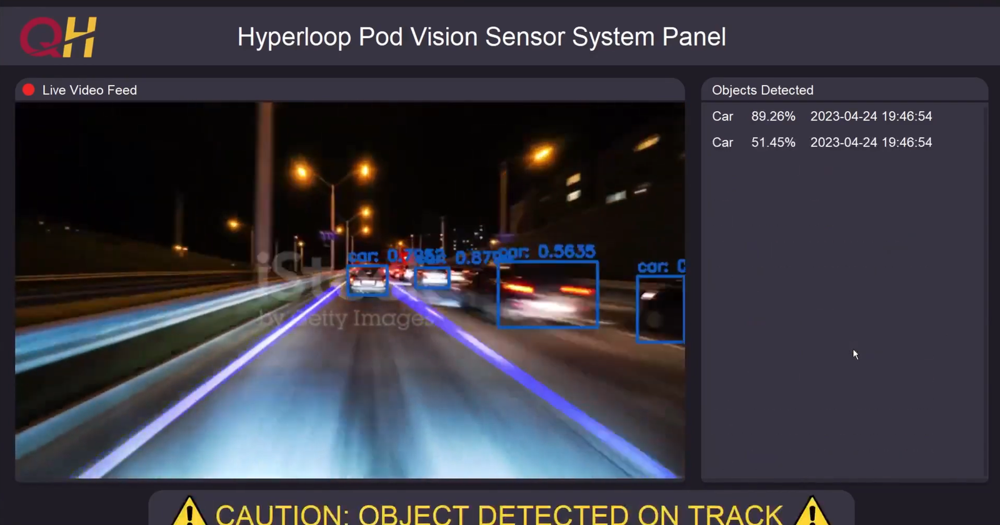
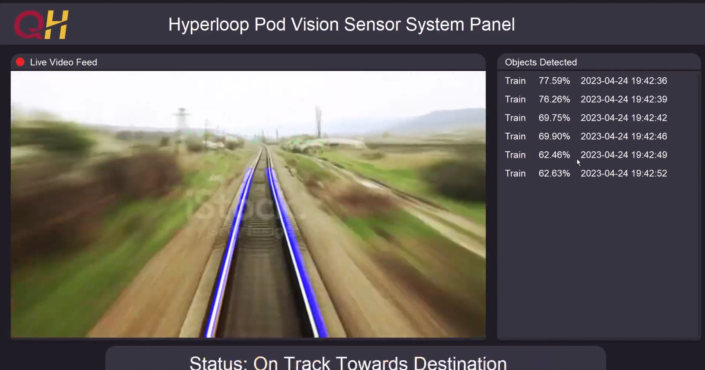
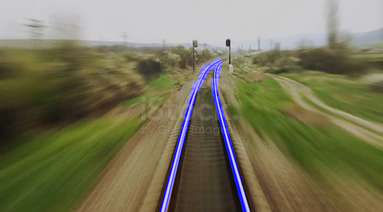

# Hyperloop Vision Sensor System

A real-time computer vision system built for the **Queen's University Hyperloop Design Team**. It watches the track through a single camera and runs two pipelines on every frame. **Lane detection** tracks the track edges and flags when the pod is deviating or its path is blocked. **Object detection** identifies and logs foreign objects ahead of the pod. The results are overlaid on a live video feed in an operator dashboard, with a status bar that escalates from normal to caution to warning as hazards appear.

| Metric | Result |
|---|---|
| Lane detection rate | **~95%** across test scenarios |
| Object detection accuracy | **~70%** |
| Sensor range | **> 20 m** ahead, **> 2 m** to each side (1080p, 60 FPS camera) |
| End-to-end latency | **≤ 1 s** from camera frame to dashboard |



**[Watch the demo](https://www.youtube.com/watch?v=gcJGPHW178M)**

---

## How It Works

```
                 ┌──────────────────────────┐
                 │  Camera / video (OpenCV) │
                 └────────────┬─────────────┘
                              │ every frame
              ┌───────────────┴───────────────┐
              ▼                               ▼
   ┌─────────────────────┐        ┌──────────────────────┐
   │   Lane detection    │        │   Object detection   │
   │ Canny + Hough lines │        │  YOLOv4 (OpenCV DNN) │
   └──────────┬──────────┘        └───────────┬──────────┘
              │ lane overlay +                │ boxes + labels +
              │ obstruction flag              │ confidences
              └───────────────┬───────────────┘
                              ▼
                 ┌──────────────────────────┐
                 │  Integration layer       │
                 │  blend overlays, set     │
                 │  status priority, log    │
                 └────────────┬─────────────┘
                              ▼
                 ┌──────────────────────────┐
                 │  Tkinter dashboard       │
                 │  live feed · object log  │
                 │  · status bar            │
                 └──────────────────────────┘
```

---

## Lane Detection

The lane detection module (`detection.py`) turns each raw frame into a pair of stable lane lines using classical computer vision. Every step is deterministic, fast enough to add no noticeable latency to the feed, and tunable in minutes for a new camera or track.

### Pipeline

1. **Grayscale conversion.** Lane edges come from changes in brightness, not colour, so dropping to one channel makes the detector independent of track and background colour.
2. **Noise reduction.** A 5×5 Gaussian blur is applied a configurable number of times (`blur_amount`). More passes suppress grain in noisy or low-light footage; fewer passes keep fine edges sharp.
3. **Canny edge detection.** Uses hysteresis thresholds (`canny_threshold_1` / `canny_threshold_2`, default 50 / 150) and outputs a binary edge map.
4. **Region-of-interest masking.** A polygon mask keeps only the area in front of the pod where lanes can actually appear. It throws away the sky, walls, and roadside clutter that would otherwise produce false lines. The polygon is a six-point shape that follows the track's perspective narrowing toward the vanishing point.
5. **Probabilistic Hough transform.** `cv2.HoughLinesP` (2 px / 1° resolution, minimum segment length 40 px, maximum gap 5 px) extracts candidate line segments from the masked edges.
6. **Left/right classification.** Each segment is fitted with `np.polyfit` to get its slope and intercept. Image coordinates put the y-axis downward, so negative slopes belong to the left lane and positive slopes to the right.
7. **Averaging and extrapolation.** The slopes and intercepts on each side are averaged into a single line. That line is projected from the bottom of the frame up to a configurable depth (`detection_range`), giving one clean, stable line per lane instead of dozens of flickering fragments.
8. **Overlay.** The two lines are drawn on a transparent layer, which the integration layer blends onto the live feed.

### Built-in safety signalling

Lane detection doubles as a hazard sensor:

- **No lane segments found:** something is covering the track, so the module returns an *obstructed* flag and the dashboard shows **"WARNING: OBJECT OBSTRUCTING PATH"**.
- **Lanes can't be resolved at all:** the dashboard shows **"WARNING: POD DEVIATING FROM TRACK"**.
- **Only one side visible:** the detector falls back to a safe default line instead of crashing, so the feed never stops.

Lane warnings take priority over object alerts in the status bar, because losing the track is the more critical failure.

### Tuning

All parameters are module-level constants at the top of `detection.py`, with comments explaining each one, so the detector can be retuned for a new camera, mounting angle, or environment in under five minutes. Tested presets for different footage are recorded in `Mask sizes.txt`.

| Parameter | Controls |
|---|---|
| `detection_range` | How far up the frame the lanes extend (smaller means further) |
| `mask_polygon` | The region where lanes are searched for |
| `blur_amount` | Noise suppression strength |
| `canny_threshold_1/2` | Edge sensitivity |
| `houghlines_threshold` | How much evidence a line needs before it counts |

### Testing



The detector was validated in low light (the pod runs inside a tube), on sharp turns, with parts of the lane blocked, with large obstructions on the track, and on noisy footage. It achieved a **~95% lane detection rate** and correctly raised warnings when the lane was obstructed or lost.

### Curved lane tracking



The integrated detector fits **straight** lines, which cover the near section of track well but lose accuracy where the track bends. I extended the algorithm to track **curved lanes** along the entire visible track, following the lanes all the way to the end instead of stopping at a fixed depth. The approach runs lane identification in two stages: the near, straight section is averaged into a single line as before, while the far, curving section keeps many short segments, chained together so the overlay bends with the track. This version worked, but it wasn't merged into the integrated system because of the project's time constraints.

---

## Object Detection

Object detection runs **YOLOv4** through OpenCV's DNN module on every frame:

- Frames are converted to 416 × 416 normalized blobs and passed through the network.
- Detections below **50% confidence** are discarded, and **non-maximum suppression** (0.3 overlap threshold) removes duplicate boxes.
- Each object gets a colour-coded bounding box and a label with its confidence.
- **Optional CUDA acceleration**: two lines in `main_program.py` switch inference to an NVIDIA GPU when OpenCV is built with CUDA.

The network is loaded **once at startup** rather than per frame. Reinitializing it on every call dropped the frame rate sharply, so it lives in the main program's scope.

### Dataset pipeline

The `object_detection/` folder contains the tooling used to build custom training data for track-specific hazards:

- Pulling classes such as **Pebble, Bolt, and Screw** from the Open Images dataset
- Converting CSV bounding-box annotations into the **YOLO format** (normalized centre, width, height)
- Generating **85% / 15% train/test splits** and the Darknet `.data` and `.names` configuration files
- Labelled sample data in `Labelled-Custom/`

Pre-trained weights don't exist for niche debris classes, so the deployed system uses the pre-trained **COCO** model (80 classes, including people, vehicles, and signs). The custom dataset pipeline is ready for training track-specific classes.

---

## Operator Dashboard

The dashboard is designed in **Figma** and implemented in **Tkinter**. It is laid out at 1920 × 1080 and **scales automatically** to any screen size.

- **Live video feed panel:** the camera feed with the lane lines and object bounding boxes blended on top.
- **Objects detected panel:** a scrolling, timestamped log of every detection with its confidence, throttled to one entry per second so it stays readable.
- **Status bar** with four states:

| State | Message | Trigger |
|---|---|---|
| Normal | Status: On Track Towards Destination | Lanes found, no objects |
| Caution (yellow) | CAUTION: OBJECT DETECTED ON TRACK | An object is detected |
| Warning (red) | WARNING: OBJECT OBSTRUCTING PATH | Lanes blocked |
| Warning (red) | WARNING: POD DEVIATING FROM TRACK | Lanes lost |

### Logging

Every detection is also recorded for later review:

- **Text logs** in `logs/YYYY-MM-DD.txt` (object, confidence, timestamp)
- **Image snapshots** of the annotated frame in `image_logs/`

---

## Integration

`main_program.py` ties everything together:

1. A single `cv2.VideoCapture` source (webcam or video file) feeds both pipelines.
2. Lane and object results are converted from BGR to RGB, resized to the panel, and **superimposed** with `cv2.addWeighted`.
3. A `critical` flag gives lane warnings priority over object alerts in the status bar.
4. The dashboard redraws through Tkinter's `after()` loop every **16 ms**, matching a 60 FPS camera. Tying the update rate to the camera frame rate, instead of polling continuously, cut processing load and power use.

---

## Running It

**Requirements:** Python 3.9+, a webcam or a video file. Developed and tested on Windows.

```bash
pip install -r requirements.txt
```

Run it from the repository root:

```bash
python main_program.py
```

To use a video file instead of the webcam, change `cv2.VideoCapture(0)` in `main_program.py` to the file name, e.g. `cv2.VideoCapture("my_video.mp4")`.

---

## Project Structure

| Path | Purpose |
|---|---|
| `main_program.py` | Integration layer, object detection loop, and Tkinter dashboard |
| `detection.py` | Lane detection pipeline |
| `frame/` | Dashboard graphics exported from Figma |
| `docs/` | Screenshots used in this README |
| `object_detection/YOLO-3-OpenCV/` | YOLO configs, class names, and standalone image/video/camera detection scripts |
| `object_detection/Custom-Data/`, `Labelled-Data/`, `Labelled-Custom/`, `Joined-Labelled-Custom/` | Dataset preparation tools and labelled data |
| `Mask sizes.txt` | Tested lane detection parameter presets |
| `logs/`, `image_logs/` | Detection logs and snapshots |
| `PROGRESS_LOG.txt` | Development history |

---

## Tech Stack

**Python** · **OpenCV** (image processing, Canny, Hough transform, DNN inference) · **YOLOv4** · **NumPy** · **Tkinter** · **Pillow** · **Figma** · **pandas** (dataset tooling)

---

## Team

| Member | Role |
|---|---|
| **Arjun Guliya** | Lane detection |
| **Aarav Shah** | Object detection |
| **Kevin Gao** | System integration |
| **Minxuan Luo** | Documentation lead and reports |
| **Saad Alam** | Front-end dashboard |

Built for the Queen's University Hyperloop Design Team.
